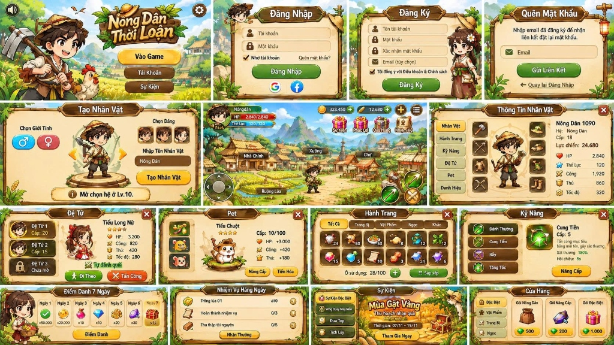

# 🌾 Nông Dân Thời Loạn (Famer RPG)

> **Game Nhập Vai Nông Trại & Chiến Đấu 2D Phong Cách Chibi Đồng Quê Việt Nam**  
> Dự án chính thức lưu trữ tại: [https://github.com/software-development-data/famer](https://github.com/software-development-data/famer)



---

## 🎮 Giới Thiệu Trò Chơi

**Nông Dân Thời Loạn** là tựa game nhập vai 2D (ARPG) kết hợp yếu tố làm nông truyền thống trong bối cảnh làng quê thanh bình xen lẫn những mối hiểm họa thời loạn lạc.

Người chơi hóa thân thành một chàng nông dân chân chất mang trong mình võ nghệ cổ truyền, cùng với đệ tử đồng hành (**Tiểu Long Nữ**) và thú cưng (**Tiểu Chuột / Gà Trống Thần**) vừa canh tác mùa màng bội thu, vừa cầm cuốc cầm cung tiễu trừ quái rừng và thổ phỉ bảo vệ bình yên cho bản làng.

---

## 🌟 Tính Năng Nổi Bật (Tái Hiện Trọn Vẹn 15 Hệ Thống)

### 1. 🌾 Thế Giới Làng Quê Sống Động
- Bản đồ thế giới mở rộng lớn với **Nhà Chính**, **Xưởng Rèn**, **Chợ Làng**, **Ruộng Lúa Thần Nông**, Đầm Sen, Hàng Trúc và **Rừng Hoang Dã**.
- Hiệu ứng thời tiết và cánh hoa, lá vàng bay lơ lửng trong gió.
- Nghỉ ngơi tại Nhà Chính để hồi phục HP và Thể Lực.

### 2. 🌱 Hệ Thống Canh Tác Gia Truyền (Ruộng Lúa)
- 6 thửa ruộng đất màu mỡ: Gieo các loại hạt giống quý (**Lúa Nếp Hoa Vàng**, **Bắp Ngọt Hoàng Kim**, **Tiên Thảo Dược**).
- Tưới nước tăng tốc độ sinh trưởng.
- Thu hoạch nông sản tươi sống để nhận Vàng, Kim Cương, Kinh Nghiệm và nguyên liệu quý.

### 3. ⚔️ Chiến Đấu & Kỹ Năng Võ Thuật Thời Loạn
- **Đánh Thường**: Đòn chém liên hoàn hình bán nguyệt quét sạch kẻ địch trước mặt.
- **Cung Tiễn (Skill 1)**: Bắn mũi tên thần xuyên thấu gây 180% sát thương diện rộng.
- **Bẫy Gai (Skill 2)**: Đặt bẫy săn thú trói chân quái vật 3 giây và gây sát thương liên tục.
- **Tăng Tốc (Skill 3)**: Tăng 80% tốc độ di chuyển trong 4 giây và tạo tàn ảnh né đòn.
- Hệ thống Nâng Cấp Kỹ Năng tăng uy lực và giảm thời gian hồi chiêu.

### 4. 🥋 Đệ Tử Đồng Hành (Tiểu Long Nữ)
- Đệ tử 4 sao xuất chiến cùng bạn trên mọi nẻo đường.
- 2 chế độ linh hoạt: **Đi Theo** (hộ tống) và **Tấn Công** (tự động lao vào đánh quái).
- Tùy chọn checkbox `Tự đánh quái`.

### 5. 🐹 Thú Cưng / Pet (Tiểu Chuột & Gà Trống Thần)
- Thú cưng đáng yêu đội nón lá vác xẻng nhảy nhót sau lưng nhân vật.
- Tự động nhặt tiền vàng và kim cương rơi trên mặt đất trong phạm vi bán kính.
- Gia tăng lượng lớn chỉ số cơ bản (+3.000 HP, +420 Công, +180 Thủ).
- Nâng cấp level pet và Tiến Hóa hào quang.

### 6. 🎒 Hành Trang Đầy Đủ 100 Ô
- Phân loại rõ ràng: *Tất Cả, Trang Bị, Vật Phẩm, Ngọc, Khác*.
- Xem thông tin chi tiết từng món đồ: Trang bị, Sử dụng (hồi máu, tăng exp pet), hoặc Bán lấy Vàng.
- Nút **Sắp Xếp** tự động và nút `+` mở rộng túi đồ.

### 7. 📜 Thông Tin Nhân Vật & 8 Ô Trang Bị
- Paper doll trang bị 8 vị trí: Nón lá, Áo giáp, Vũ khí chính, Hài cỏ, Hộ thủ, Dây chuyền, Nhẫn may mắn, Huân chương.
- Hiển thị đầy đủ: Cấp độ, Lực Chiến (glowing gold), HP, Thể Lực, Công, Thủ, Tốc Độ.

### 8. 🎁 Phúc Lợi 7 Ngày & Nhiệm Vụ Hàng Ngày
- **Điểm Danh 7 Ngày**: Nhận Vàng, Exp, Bình máu đại, Kim Cương, Đá nâng cấp và Rương Thần.
- **Nhiệm Vụ Hàng Ngày**: Theo dõi tiến độ thời gian thực (Trồng lúa, Tiêu diệt quái rừng, Thu thập tài nguyên) và bấm nhận thưởng Vàng + Kim Cương.

### 9. 🎡 Sự Kiện Mùa Gặt Vàng & Vòng Quay May Mắn
- Sự kiện giới hạn: Thu hoạch mùa vàng nhận quà đặc biệt.
- **Vòng Quay May Mắn (Lucky Wheel)**: Minigame vòng quay với kim chỉ và giải thưởng hấp dẫn!
- Bảng Xếp Hạng Đua Top Lực Chiến máy chủ.

### 10. 🏪 Cửa Hàng Thần Nông
- Các gói quà ưu đãi: **Gói Nông Dân**, **Gói Nâng Cấp**, **Gói Đặc Biệt**.
- Mua hạt giống nông sản, dược phẩm và vũ khí cường hóa.

### 11. 🎵 Âm Thanh & BGM Đồng Quê Độc Quyền
- Tự động tổng hợp âm thanh bằng **Web Audio API** (không cần tải file mp3 rời, chạy mượt mọi nơi).
- Nhạc nền ngũ cung êm dịu, tiếng cuốc chém, tiếng tên bay, tiếng thu hoạch, tiếng nhặt vàng, tiếng thăng cấp.

---

## 🕹️ Hướng Dẫn Điều Khiển

| Thao Tác | Phím Desktop | Cảm Ứng Mobile / Tablet |
| :--- | :--- | :--- |
| **Di chuyển** | `W`, `A`, `S`, `D` hoặc Phím Mũi Tên | Joystick ảo góc dưới bên trái |
| **Đánh Thường** | Phím `Space` hoặc `J` | Nút Kiếm vàng to góc dưới bên phải |
| **Bắn Cung Tiễn** | Phím `K` | Nút Cung tên xanh lá |
| **Đặt Bẫy Gai** | Phím `L` | Nút Bẫy cam |
| **Tăng Tốc** | Phím `Shift` hoặc `U` | Nút Sấm sét xanh dương |
| **Tương tác / Nhặt** | Phím `E` | Nút nổi tương tác giữa màn hình |
| **Mở Hành Trang** | Phím `B` hoặc `I` | Icon Túi đồ / Avatar |
| **Xem Nhân Vật** | Phím `C` | Bấm vào khung Avatar trên cùng |
| **Di chuyển chuột** | Click chuột vào vị trí bất kỳ | Chạm vào màn hình |

---

## 🚀 Hướng Dẫn Cài Đặt & Chạy Trực Tiếp

### Cách 1: Chạy trực tiếp (Không cần build)
Vì dự án được xây dựng bằng công nghệ Web chuẩn (HTML5, CSS3, Vanilla ES Modules), bạn chỉ cần mở file `index.html` bằng trình duyệt web có hỗ trợ local server hoặc dùng VS Code Live Server.

### Cách 2: Chạy với Node.js / npx
```bash
# Clone repository
git clone https://github.com/software-development-data/famer.git
cd famer

# Khởi chạy server tĩnh
npm start
# Hoặc:
npx serve .
```
Truy cập trình duyệt tại: `http://localhost:3000` (hoặc cổng mà terminal thông báo).

---

## 🌐 Triển Khai GitHub Pages Tự Động

Repository đã tích hợp sẵn GitHub Actions workflow tại `.github/workflows/deploy.yml`.  
Mỗi khi commit và push code lên nhánh `main`, hệ thống sẽ tự động build và xuất bản game lên GitHub Pages:
- **URL dự kiến**: `https://software-development-data.github.io/famer/`

---

## 📁 Cấu Trúc Mã Nguồn

```
famer/
├── index.html                  # Giao diện chính của game & toàn bộ 15 modal
├── README.md                   # Tài liệu hướng dẫn chi tiết
├── package.json                # Cấu hình package & scripts
├── .gitignore                  # File git ignore
├── .github/
│   └── workflows/
│       └── deploy.yml          # Quy trình triển khai tự động lên GitHub Pages
├── css/
│   ├── style.css               # Typography, reset, toast notifications
│   ├── game.css                # Khung nhìn game, HUD, Joystick, nút chiến đấu
│   └── modals.css              # Khung tre/gỗ, form đăng nhập, 100 ô túi đồ, sự kiện
├── js/
│   ├── audio.js                # Bộ tạo âm thanh & nhạc nền ngũ cung Web Audio API
│   ├── state.js                # Quản lý state nhân vật, lưu dữ liệu localStorage
│   ├── world.js                # Bản đồ thế giới, các công trình (Nhà Chính, Xưởng, Chợ, Ruộng Lúa)
│   ├── entities.js             # Lớp nhân vật, Đệ tử, Pet, Quái vật, Bẫy, Mũi tên
│   ├── farming.js              # Hệ thống gieo hạt, tưới nước, sinh trưởng, thu hoạch
│   ├── combat.js               # Tính toán sát thương, kỹ năng, rơi đồ, floating text
│   ├── renderer.js             # Canvas 2D engine kết xuất đồ họa làng quê, cây cối, quái
│   ├── ui.js                   # Xử lý toàn bộ logic 15 màn hình / modal, vòng quay may mắn
│   └── main.js                 # Vòng lặp game loop chính & tiếp nhận điều khiển
└── assets/
    └── images/                 # Hình ảnh nhân vật, icon, texture và reference UI gốc
```

---

## 📜 Bản Quyền & Giấy Phép

Phát triển bởi đội ngũ **software-development-data**. Giấy phép mã nguồn mở MIT.
